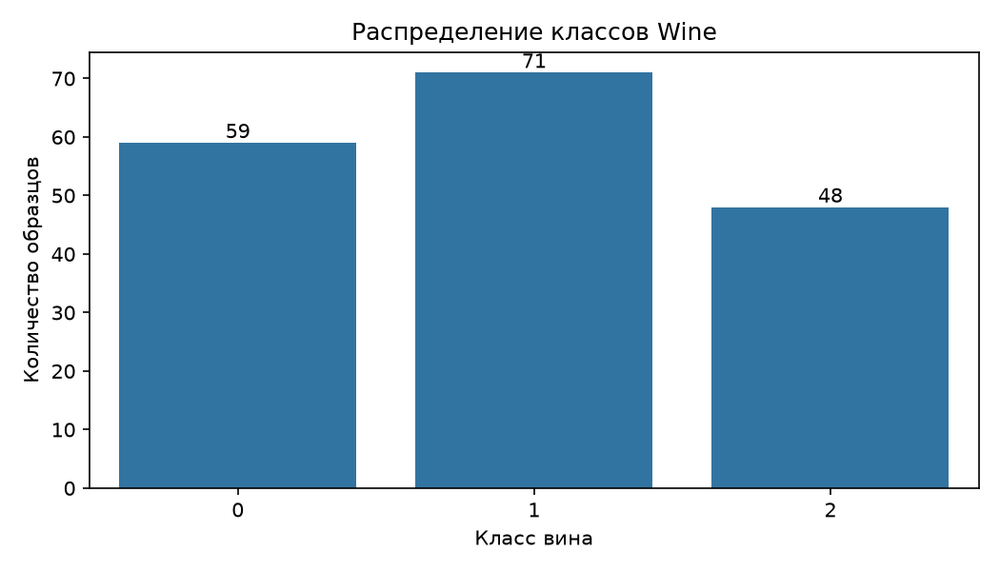
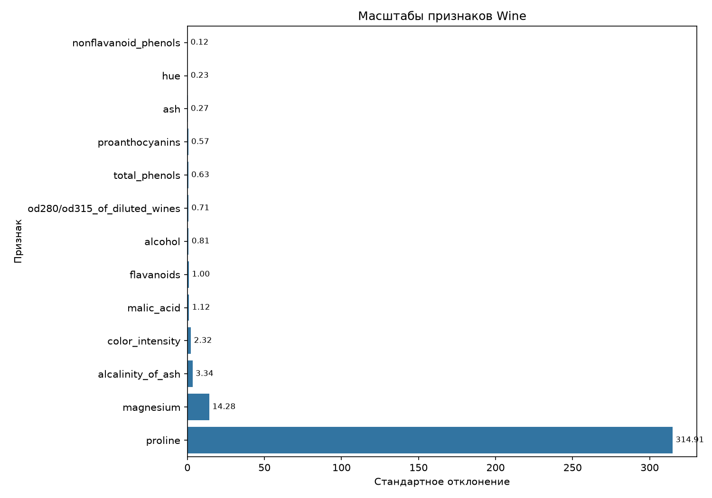
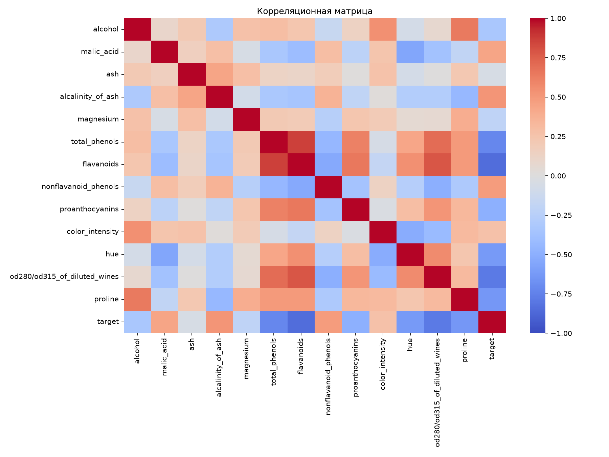

# Лабораторная работа № 1 — EDA

**Вариант:** 02 — Wine
**Дата анализа:** 2026-10-26
**Источник:** `sklearn.datasets.load_wine`
**Файл:** `data/raw/wine.csv`

## 1. Паспорт данных

| Показатель | Значение |
|---|---:|
| Наблюдения | 178 |
| Всего столбцов | 14 |
| Признаки без `target` | 13 |
| Числовые признаки | 13 |
| Целевых классов | 3 |
| Пропущенные значения | 0 |
| Полные дубликаты строк | 0 |

## 2. Качество данных

**Пропуски по столбцам:** Пропусков нет.

Полные дубликаты учитываются по всем столбцам, включая `target`.
Выбросы автоматически не удалялись: их наличие само по себе не означает ошибку данных.

## 3. Распределение классов

| Класс | Количество | Доля, % |
|---:|---:|---:|
| 0 | 59 | 33.15 |
| 1 | 71 | 39.89 |
| 2 | 48 | 26.97 |

## 4. Масштабы признаков

Отношение максимального стандартного отклонения к минимальному ненулевому: **2530.33**.

Признак с наибольшим стандартным отклонением: **proline** (314.907).

Признак с наименьшим ненулевым стандартным отклонением: **nonflavanoid_phenols** (0.124).

## 5. Связи между признаками

Наибольшая по модулю корреляция между парами признаков: `total_phenols` и `flavanoids` (ρ = 0.865).

Наибольшая по модулю корреляция числового признака с `target`:
**flavanoids** (коэффициент корреляции Пирсона = -0.847).

Корреляция не доказывает причинно-следственную связь. Числовой код `target` также не следует трактовать как непрерывную величину.

## 6. Выводы

1. В наборе данных **178 наблюдений** и **13 числовых признаков**.
2. Обнаружено **0 пропущенных значений**; число полных дубликатов — **0**.
3. Отношение стандартных отклонений равно **2530.33**, поэтому перед использованием kNN и SVM следует проверить стандартизацию признаков.
4. Наибольшая корреляция с числовым кодом целевого класса у признака **flavanoids**: **-0.847**; это описательная связь, а не доказательство причинности.
5. Наиболее сильно связанные между собой признаки: `total_phenols` и `flavanoids` (ρ = 0.865). Полный список сохранён в `top_correlations.csv`.

## 7. Артефакты и воспроизводимость

- `eda_stats.csv` — описательная статистика и корреляция с `target`.
- `feature_scale_stats.csv` — средние и стандартные отклонения признаков.
- `top_correlations.csv` — десять наиболее сильных корреляций между признаками.
- `figures/class_distribution.png` — распределение классов.
- `figures/feature_scales.png` — масштабы признаков.
- `figures/correlation_heatmap.png` — корреляционная матрица.

Для повторного построения отчёта запустите `python src/eda.py` из корня проекта.
